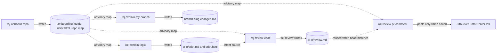

# agent-skills

Agent skills for code review, code comprehension, repository onboarding,
root-cause investigation and DevOps team workflows. Each skill is one
self-contained [Agent Skills](https://agentskills.io/specification) folder,
so the same `SKILL.md` serves Claude Code, GitHub Copilot (VS Code and
JetBrains) and any other agent the [`skills`](https://skills.sh) CLI
supports.

## Install

**Skills, with Cali (recommended)** — [Cali](https://github.com/rojcarranza/cali)
reads the skills from this repo on GitHub, so there is nothing to clone.
This repo is only the list ([`cali.yaml`](cali.yaml) and `skills/`); Cali
installs, pins and records what you load in your own `cali.yaml` and
`cali.lock`.

1. Install `cali`: `go install github.com/rojcarranza/cali/cmd/cali@latest`,
   or `make install` from a clone of its repo.
2. Tell Cali where the skills are, once, then load what you need from any
   folder:

   ```bash
   cali setup github:rojcarranza/agent-skills
   cali load roj-one-slide
   cali status -g          # what is installed, and what has a newer version
   cali update -g          # newer versions; add --apply to take them
   ```

   On WSL, `cali setup` also finds your Windows home, so a load fills both
   the Linux home and `%USERPROFILE%` (what Windows-side VS Code and
   JetBrains read).

**The extras, with `install.py`** — personal instructions, the Superpowers
start-up note, the JetBrains instruction block, the removal of the retired GitHub MCP server entry and
`graphify`. It installs no skills and never runs `cali`:

```bash
git clone https://github.com/rojcarranza/agent-skills && cd agent-skills
python3 install.py --target both        # or claude / copilot
python3 install.py --status             # what it wrote, leftovers
```

On Windows use Git Bash and `python`. On WSL run it inside WSL: it also
writes the JetBrains block into your Windows home (`--windows-home PATH` names
it if it cannot be found). `--update` only points to `cali update -g`.

`install.py` no longer registers the GitHub MCP server: use
[`gh-axi`](https://github.com/kunchenguid/axi) instead. A run removes the
`github-mcp-server` entry it wrote earlier from `~/.claude.json` and
`~/.copilot/mcp-config.json`, and leaves every other server alone.

Folders earlier versions of `install.py` left in your skills folders are no
longer touched; `cali doctor` lists them. Earlier versions of `install.py`
also linked `~/.config/cali/cali.yaml` to this clone's `cali.yaml`. If you
ran one, remove the link so Cali writes your loads in your own file, not in
the clone: `rm ~/.config/cali/cali.yaml` (or under `$CALI_CONFIG_DIR` /
`$XDG_CONFIG_HOME`), then run `cali setup github:rojcarranza/agent-skills`.

To add or drop a skill in the list, edit `cali.yaml` here.

**Only some skills, with Node.js** — `npx skills add rojcarranza/agent-skills`
(interactive), or `-s <skill> -a github-copilot -g`.

**In a team repository** — run Cali inside that repo, without `-g`, naming
each skill's folder:

```bash
cali add github:rojcarranza/agent-skills//skills/roj-review-code --target copilot
cali add https://bitbucket.example.com/scm/PROJ/team-skills.git//skills/<name> --target copilot
```

The second line is a Bitbucket Data Center repository, named by its clone
address (`scm/~user/repo.git` for a personal one). Cali installs into
`.github/skills/` and pins each skill to a commit in `cali.yaml` and
`cali.lock` in the repo root. Commit all three: Copilot reads
`.github/skills/` in every clone, and a teammate with Cali runs `cali sync`
once after cloning so `cali status` and `cali update` work there.

Every flag, the manifest, externals (`graphify`), the Windows VDI and
JetBrains setup are in [docs/installer.md](docs/installer.md).

Putting a repo behind local `no-mistakes` gates, and updating the pinned
tools, is in [docs/workflow.md](docs/workflow.md).

## Skills

| Skill | What it does |
| --- | --- |
| [`roj-review-code`](skills/roj-review-code/USAGE.md) | Reviews a branch, a teammate's branch or a Bitbucket Data Center PR, without a checkout: A PR gets a full review by default (change summary, severity/confidence-tagged findings, a report in `.pr-review/pr-<n>/review.md`) and a `Comments to paste` section of `path:line` comments for the author; say `quick` for a short one. Every review opens with a walkthrough of the change (what and why, files, read-first order, effort, and a flow diagram in full mode) and ends its findings with non-blocking Major or Minor recommendations on logic, code comments and design, on for every target; say `no suggestions` to drop them. For your own branch `auto` picks a quick chat-only pass or a full review from the size and risk of the diff (deploy, CI, Ansible, auth, migrations). Optional intent source (PR text, Jira story, SB acceptance criteria). Loads language/platform rules (Java, Python, Bash, Go, Bamboo, Docker, k8s, Helm) only for stacks the diff touches. Git-only. |
| [`roj-review-pr-comment`](skills/roj-review-pr-comment/USAGE.md) | Reviews a Bitbucket Data Center PR with the same method, fetched by ref with no checkout, and drafts the findings as pasteable `path:line` comments. Posts them through the Bitbucket REST API only when asked and a `BITBUCKET_TOKEN` is set; a post holds the defects only unless you say `improve`. Reuses the findings of a full review of the same head from `.pr-review/pr-<n>/review.md` instead of reviewing twice; non-blocking suggestion comments are on by default (`no suggestions` for defects only), in the comment format `roj-review-code` shares. The only skill that writes to the PR host. |
| [`roj-explain-logic`](skills/roj-explain-logic/USAGE.md) | Guided walkthrough of a PR, branch, file or function: big picture → execution flow → why → gotchas, with language lenses. A PR or branch is written as a brief in `.pr-review/pr-<n>/` (`brief.md` plus a one-page `brief.html`) with a flow diagram of what the change touches. Optional explain-and-review mode. |
| [`roj-explain-my-branch`](skills/roj-explain-my-branch/USAGE.md) | Explains your own branch against `develop`/`main` with traced before/after behaviour, then writes PR-ready text and per-change comments. |
| [`roj-onboard-repo`](skills/roj-onboard-repo/USAGE.md) | Onboarding into an unfamiliar repo: a Markdown guide in `.onboarding/` plus a one-page `index.html` (open it in Lavish or a browser) with Mermaid diagrams of the architecture and a core flow, a code walkthrough anchored to `path:line`, a reading order, and a page on reviewing a colleague's PR. Stops on a failed read instead of guessing. CodeTour only on request. |
| [`roj-investigate-issue`](skills/roj-investigate-issue/USAGE.md) | Problem `.md` in, validated root cause and fix steps out (Bamboo, Java, Python, Bash, Go, Docker, k8s); searches resolved Jira issues and Confluence pages for an earlier fix. |
| [`roj-soundboarding`](skills/roj-soundboarding/USAGE.md) | User story (file, pasted Jira text or Jira key) → code-investigated SB document → task-by-task implementation with review stops. Never touches git. |
| [`roj-grill-plan`](skills/roj-grill-plan/USAGE.md) | Grills a story, SB document or plan in rounds of questions with recommended answers, looks facts up itself, then writes the decisions back into the file. |
| [`roj-interview-prep`](skills/roj-interview-prep/USAGE.md) | DevOps technical-interview document generated from a candidate's CV. |
| [`roj-one-slide`](skills/roj-one-slide/USAGE.md) | One demo slide for a finished story (SB document, story file or ticket text), built on your team's own `.pptx` template: linked key and title, the Goal, how it was implemented, the result and what is next, with one optional visual: steps, a screenshot or a changed path. Renders and checks the slide when LibreOffice is installed. Never touches git. |

**Archived:** `roj-idea-to-project` (raw app idea → build-ready project,
for Claude Code) was removed in #92. The last commit that has it is
[`4529a19`](https://github.com/rojcarranza/agent-skills/tree/4529a190bf9a455d2c02b7f896ca7aa41ae41778/skills/roj-idea-to-project);
`git checkout 4529a19 -- skills/roj-idea-to-project` brings it back.
`install.py` no longer touches installed skills; delete an old copy by hand.

Diagrams are always Mermaid: `roj-onboard-repo` puts a system map and a
core-flow diagram in `.onboarding/README.md`, `roj-explain-logic` puts a flow
diff of a PR in `.pr-review/pr-<n>/brief.md`, and the explain skills draw
flows and before/after structure the same way. GitHub renders them; VS Code
1.121 and later renders them in the built-in Markdown preview, JetBrains in
the Markdown preview with its Mermaid plugin ticked.

Skills that read code ask a [graphify](docs/installer.md#how-our-skills-use-the-graph)
graph first when the repo has one (`graphify-out/`), and read only the files
it points at — fewer tokens on large repos. Build one per repo with
`graphify update .` (code only, no LLM).

The PR skills (`roj-explain-logic`, `roj-review-code`,
`roj-review-pr-comment`, `roj-explain-my-branch`) also read the
`.onboarding/` map `roj-onboard-repo` writes, when one exists: they name the
areas, dependents and silent seams a change touches. The map only orients;
every finding and explanation step still cites the code.

Walkthrough skills **offer** a CodeTour at the end of a run and write one
into `.tours/` only on a yes, chaining to the community `code-tour` skill.
`roj-onboard-repo` follows the same rule: its output is the `.onboarding/`
guide, and a tour is written only when asked.

Community skills these chain to (`code-tour`, `acquire-codebase-knowledge`,
`write-pr-description`, ...) are described in
[docs/community-skills.md](docs/community-skills.md). Every skill degrades
to an inline fallback when a community skill is missing.

## How the skills fit together

Five skills cover a repository from first day to a posted review. They share
files, not state: each writes under the repository root and the next one
reads what is there.



Solid arrows are writes, dotted arrows are reads. `.pr-review/` holds the
`brief.md` and `review.md` files, one folder per PR. The map is advisory: it
names the areas and dependents a change touches, and every finding still cites
the code. `roj-review-pr-comment` is the only skill that writes to the PR
host.

### Which branch to be on

- **Onboarding and a colleague's PR:** stay on the branch the PRs merge into
  (`develop`, or `main`), up to date, and use that checkout for everything.
  `roj-onboard-repo` maps the commit you have checked out, so a map built
  there describes what PRs land on. Do not check out the feature branch to
  skip the PR number: the PR skills fetch the PR head by ref and never need a
  checkout, and a checked-out feature branch would only make the map describe
  the wrong code.
- **Pass the PR, not the branch:** a Bitbucket URL carries the PR id and the
  target branch. A bare id needs the target said once ("it merges into
  `develop`"), and must belong to the repository your `origin` points at.
  With no argument `roj-explain-logic` asks which PR, `roj-review-pr-comment`
  asks for the id, and `roj-review-code` reviews your current branch.
- **Check out the feature branch** only to run or debug it, or to review your
  own work: with no argument `roj-review-code` reviews the current branch
  plus staged, unstaged and untracked changes, and
  `roj-explain-my-branch` explains the current branch against its base
  (it stops on the base branch itself and leaves uncommitted files out).
- **Keep the output out of Git:** `.onboarding/` and `.pr-review/` live in the
  working tree, so they survive a branch switch, but nothing ignores them for
  you. Each skill prints the `echo '<dir>/' >> .git/info/exclude` line when its
  folder is not ignored, and never runs it or edits `.gitignore`.
- **Refresh the map** by re-running `roj-onboard-repo` on the up-to-date target
  branch. The PR skills print `Repo map: .onboarding @ <sha7> (<state>)`; once
  it says behind or stale, refresh. A missing map never blocks a run, and a
  quick review does not read it.

In JetBrains write `/skill:roj-explain-logic PR 142`; in VS Code write
`/roj-explain-logic PR 142`.

### Workflow 1: get into a repository

1. Check out the branch PRs merge into and pull it.
2. Run `roj-onboard-repo`. A monorepo asks which workspace; an existing
   `.onboarding/` asks refresh or keep.
3. Open `.onboarding/index.html` in a browser (or Lavish), or the Markdown in
   the IDE preview. Start with the reading order and `reviewing-prs.md`.
4. Re-run it on the target branch when the map reports itself behind.

### Workflow 2: understand, review and comment on a colleague's PR

Stay on the target branch. Every step takes the PR URL or id.

1. `roj-explain-logic PR <n>` writes `.pr-review/pr-<n>/brief.md` and
   `brief.html`: what the change does, with a flow diagram.
2. `roj-review-code PR <n>` reviews the PR head in full: it writes
   `.pr-review/pr-<n>/review.md`, uses `brief.md` as the intent source, adds
   non-blocking suggestions kept apart from the defects, and ends with a
   `Comments to paste` section, one `path:line` block per defect and per
   suggestion, ready for Bitbucket. Say `quick` for a chat-only pass or
   `no suggestions` for defects only.
3. `roj-review-pr-comment PR <n>` drafts pasteable `path:line` comments. It
   reuses `review.md` when its head SHA matches the PR head and suggestions
   were covered, so the PR is not reviewed twice.
4. Post only when you ask for it and `BITBUCKET_URL` and `BITBUCKET_TOKEN`
   are set; otherwise paste the draft into Bitbucket yourself. A post holds
   the defect comments only; add `improve` to post the suggestions too.

### Workflow 3: review your own branch before the PR

1. Check out your feature branch.
2. `roj-review-code` with no argument finds defects in the branch plus your
   uncommitted work. Fix them.
3. Commit, then run `roj-explain-my-branch` (optionally with a base such
   as `develop`). It writes `<branch-slug>-changes.md` at the repository root
   with a PR description and per-change comments you can paste. Add that file
   to `.git/info/exclude` too if you do not want it committed.

## Repository layout

```text
skills/<name>/
  SKILL.md        frontmatter (name, description, license) + instructions, < 500 lines
  USAGE.md        human guide: commands per agent, worked example
  references/     detail the agent loads on demand
  assets/         templates the skill fills in
  examples/       sample inputs and outputs
cali.yaml         every skill and community skill, as a list Cali reads (`cali setup`)
instructions/      personal instructions install.py deploys to Copilot
tools/            sync_shared.py — copies shared files into every skill using them
                  baseline_size.py - fails a code file over 1,000 lines
.baseline-long-files  code files over 1,000 lines when the limit came in; they may shrink, never grow
install.py        deploys instructions, removes the retired GitHub MCP entry, installs graphify; installs no skills (docs/installer.md)
test_install.py   installer tests
test_skills.py    spec, publishing, evals and description-routing checks
test_baseline_size.py  the 1,000-line limit checks
```

## Writing or changing a skill

- Follow the [Agent Skills spec](https://agentskills.io/specification): the
  `name` matches the folder, lowercase with hyphens and a `roj-` prefix; the
  `description` says what the skill does **and** when to use it, under
  700 characters (the spec allows 1024, but every description loads into
  every session), written in the third person ("Reviews ...", never "you").
  Add an `argument-hint` such as `[PR id or URL]` for the slash-command menu.
  Quote a value containing ` #` or `: `.
- Keep `SKILL.md` lean — every installed skill's description loads into
  every session, and the body loads in full on activation. Push detail into
  `references/` and point at it with a path relative to the skill root.
  Keep references one level deep — a reference file may name a sibling only
  when `SKILL.md` names it too — and open any reference over 100 lines with
  a `## Contents` list.
- Declare what the skill needs so `cali doctor` can warn before a run fails:
  under `metadata`, `cali-env` lists the environment variables it reads that
  have no default (`BITBUCKET_URL, BITBUCKET_TOKEN`) and `cali-tools` the
  programs it runs (`git, python3|python`). Write Python as `python3|python`
  so either name passes. Leave out optional programs such as `graphify`, and
  variables with a fallback such as `$SOUNDBOARD_DIR`. A test fails when a
  bundled Python script reads a variable the skill does not declare, or when
  a declaration names something the skill's body, references and scripts
  never use.
- A skill reads only its own folder. When two skills need the same file,
  the owner keeps it and `tools/sync_shared.py` copies it in — edit the
  owner's copy, then run `python3 tools/sync_shared.py`.
- No personal paths, ticket IDs or employer details — use placeholders
  (`PROJ-123`, `$SOUNDBOARD_DIR`). Put employer-specific strings in a
  git-ignored `.private-patterns` file (one regex per line) and the tests
  check for them locally.
- A new skill is one PR: the `skills/<name>/` folder and its `cali.yaml`
  entry (`source: .//skills/<name>`). Cali pins it in the loader's own
  `cali.lock`; this repo keeps none.

## Tests

```bash
python3 -m unittest test_install test_skills test_baseline_size -v
python3 tools/sync_shared.py --check
python3 tools/baseline_size.py        # no code file over 1,000 lines
npx skills add . --list               # what skills.sh will discover
```

The no-mistakes gate runs all four on every push (GitHub Actions is off, see
[docs/workflow.md](docs/workflow.md)). A code file over 1,000 lines fails
unless `.baseline-long-files` lists it, and a listed file may shrink but never
grow: lower its count when it shrinks, and remove its line once it is under
the limit.

### Evals

`evals/<skill>/` holds [skill-creator](https://github.com/anthropics/claude-plugins-official/tree/main/plugins/skill-creator)
eval sets, kept outside `skills/` so no install ships them. Every skill
needs both files, and `test_skills.py` also fails when two descriptions
route one trigger phrase ambiguously:

- `triggers.json` — realistic prompts marked `should_trigger`, mostly
  near-misses aimed at sibling skills, to test the `description`.
- `evals.json` — behaviour checks in skill-creator's schema.

Run a trigger set from an empty scratch directory with its own `.claude/`
— the runner writes temporary command files into the nearest one, which
is otherwise `~/.claude/`. It calls `claude -p` once per query, so it costs
tokens:

```bash
mkdir -p /tmp/skill-evals/.claude && cd /tmp/skill-evals
PYTHONPATH=<skill-creator dir> python3 -m scripts.run_eval \
  --eval-set <repo>/evals/<skill>/triggers.json \
  --skill-path <repo>/skills/<skill> --num-workers 1
```

Keep `--num-workers 1`: every worker drops a copy of the skill into the
same `.claude/commands/`, so parallel runs see several identical skills,
invoke another worker's copy and score a miss. A skill you already have
installed competes with its own copy, so its should-trigger scores read
low.

`run_eval` reads only `triggers.json`. Behaviour checks in `evals.json`
run through the skill-creator skill itself: ask Claude, with skill-creator
loaded, to run `evals/<skill>/evals.json` against `skills/<skill>`. It
runs each prompt with and without the skill, grades the outputs against
`expectations`, and opens its review viewer.

Each behaviour eval names the repository it runs in under `fixture`.
Build a fresh one per run, so no run sees another's output:

```bash
evals/fixtures/build.sh <fixture.repo> /tmp/run-1          # repo at /tmp/run-1/repo
python3 evals/fixtures/fake_bitbucket.py /tmp/run-1 <fixture.bitbucket> &   # PR-comment evals only
```

The fake Bitbucket serves PR 7 of `APP/uploader` from that repository on
127.0.0.1 and prints `BITBUCKET_URL=http://127.0.0.1:<port>`; export that and
`BITBUCKET_TOKEN=test-token` for the run. It records every request line and
the comments it accepts under `/tmp/run-1/bb-state/` instead of reaching a
real server; stop it afterwards and grade from those files.

`test_skills.py` checks that every fixture builds and the files' shape,
not the scores.

## License

[MIT](LICENSE)
