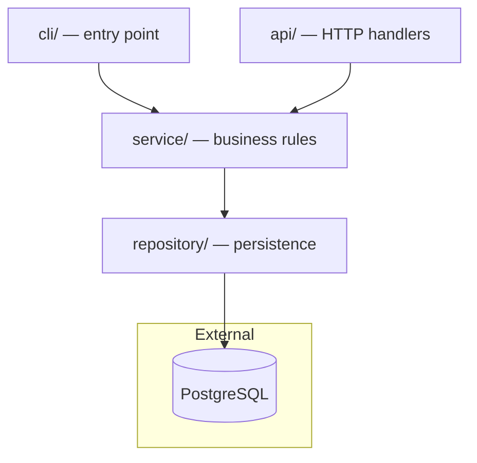
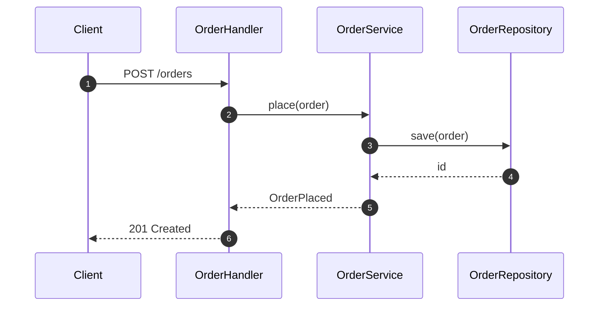

# Mermaid diagrams

Every diagram a skill writes — in chat, in a report, in `.onboarding/` or
`.pr-review/` — is a fenced ```` ```mermaid ```` block. No ASCII art, no
indented trees, no images. Mermaid renders on GitHub and in the IDE preview, and stays a
reviewable text diff.

## Contents

- Pick the diagram for the job
- Draw from evidence
- The safe subset
- Flow diff: a sequence diagram of what a change touches
- Syntax that renders the first time
- Pitfalls
- Validate
- Viewing
- Examples

## Pick the diagram for the job

| Job | Diagram | Start with |
| --- | --- | --- |
| layers, modules, services and which way dependencies point | flowchart | `flowchart TD` |
| one runtime path: who calls whom, in order | sequence | `sequenceDiagram` with `autonumber` |
| a pipeline: CI stages, render order, plan → stage → job | flowchart | `flowchart LR` |
| key abstractions and one implementation of each | class | `classDiagram` (three or more real types) |
| a lifecycle: job, order, deployment states | state | `stateDiagram-v2` (only when a state field or enum exists) |
| data shapes and their relations | entity-relationship | `erDiagram` (only when real tables or models exist) |
| before/after of a structure | two flowcharts | `flowchart LR` each |
| what a PR changes, step by step | flow diff | `sequenceDiagram` with `rect` blocks (see below) |

One diagram answers one question. At most 15 nodes and 25 edges per diagram;
when a picture needs more, split it (one per layer, or one overview plus one
zoom) rather than shrink it. At most eight diagrams per run.

## Draw from evidence

- Every node is something that exists in the repository: a directory,
  module, class, function, service, queue or table. Label it with the real
  name; add the path when the reader will look for it
  (`api["api/ — HTTP handlers"]`).
- Every edge is a call, an import, a message or a data flow you read in the
  code. Label edges whose meaning is not obvious (`-->|"publishes OrderPlaced"|`).
- Arrows point the way the dependency or the call goes, never the reverse.
- External systems (databases, brokers, third-party APIs) go in a
  `subgraph External` or use the cylinder shape `db[("orders DB")]`.
- Group by real boundaries with `subgraph`: a layer, a deployable, a package.

## The safe subset

Five types, tested to parse on Mermaid 8.14.0, 9.4.3, 10.9.3 and 11.12.0,
which covers every IDE bundle seen so far: `flowchart` (`TD` or `LR`, with
subgraphs, cylinders and edge labels), `sequenceDiagram` (`autonumber`,
`alt`, `Note`, `rect`), `classDiagram`, `stateDiagram-v2`, `erDiagram`.

Use `flowchart`, not `graph`. Never use `architecture-beta`, `block-beta`,
`mindmap`, C4 diagrams, `zenuml`, `@{ shape: ... }` nodes, `fa:` icons,
`%%{init}%%`, `click` or HTML in labels: each fails or renders differently on
at least one host.

## Flow diff: a sequence diagram of what a change touches

The one place colour carries meaning. A diagram of a PR draws only the steps
the change adds, alters or removes, in run order, each class in its own
`rect` block (a translucent fill, so it reads in light and dark themes):

```text
rect rgba(0,180,0,0.12)      new
rect rgba(255,190,0,0.15)    changed
rect rgba(220,0,0,0.12)      removed
```

Colour is not the only signal, because a host may ignore it. Every message
and note starts with a tag, `+` new, `~` changed, `-` removed, and ends with
its evidence tier word (`read`, `inferred` or `ran`):

```text
A->>S: + token-status, read
Note over A,G: - removed: gh pr diff and gh api reviews POST, read
```

A removed step has nothing left to call, so it is a `Note over` inside a red
block, not a message, and not numbered. `autonumber` numbers messages only,
so the numbers line up with the proof list. At most 12 steps and 5
participants. `rect` takes `rgba(...)` or `rgb(...)` only, no `%%{init}%%`
and no `classDef`.

## Syntax that renders the first time

- Quote every label: `svc["OrderService.place()"]`. Unquoted `()`, `[]`, `{}`
  change the shape or break the parse.
- Node IDs are short, alphanumeric and unique: `api`, `orderSvc`, `db1`.
  Never use `end`, `graph`, `subgraph`, `class` or `style` as an ID;
  `end` in lowercase breaks the whole flowchart.
- Keep labels to one short line; no `<br>` or other HTML.
- In `sequenceDiagram`, declare `participant` lines first, in the order the
  reader meets them, and alias long names: `participant OS as OrderService`.
- No theme, `%%{init}%%` or `classDef` colour styling. Diagrams must read in
  light and dark themes with the renderer's defaults; the only colour is the
  `rect` blocks of a flow diff, which carry a `+` `~` `-` tag as well.
- One blank line before and after the fence; nothing else on the fence line
  but `` ```mermaid ``.

## Pitfalls

Each row was run against Mermaid 11.12 unless marked "documented".

| Pitfall | Result | Fix |
| --- | --- | --- |
| Unquoted `()` in a label: `a[OrderService.place()]` | parse error | quote it: `a["OrderService.place()"]` |
| Node id `end` | parse error | `finish`; `End` is fine as a subgraph name |
| `;` in a sequence message: `C->>H: a; b` | parse error | use a comma or a dash |
| Unquoted `\|` in an edge label | parse error | quote it: `-->\|"a or b"\| c` |
| `"` inside a quoted label | parse error | write `#quot;` |
| Misspelled type (`flowchat`) | "No diagram type detected" | first line is a type from the subset |
| More than 500 edges | "Edge limit exceeded" | split; our limit is 25 |
| More than 50,000 characters | documented: "Maximum text size in diagram exceeded", with no way to raise it in some JetBrains builds | split; the 15-node rule keeps a block near 1 KB |
| `A---oB` | documented: `---o` is the circle edge, not an edge to `oB` | put a space before an id that starts with `o` or `x` |
| `<br/>`, `click`, `fa:` icons | parse, but render differs by host | do not use |
| Emoji in a label | parses on 8.14.0, 10.9.3 and 11.12.0; glyph support in an IDE preview unverified | keep emoji in the prose, use `+` `~` `-` in labels |
| `@{ shape: cyl }`, `architecture-beta` | fail on 8.14, 9.4.3, 10.9.3 | use `[( )]` for a cylinder, a flowchart for the rest |
| `block-beta`, `mindmap` | fail on 8.14.0 and 9.4.3 | do not use |
| `C4Context`, `zenuml` | fail on 8.14 and 11.12 respectively | do not use |

A clean parse says nothing about whether a diagram is true: every node must be
in the evidence ledger and every edge a call, import or message you read.

## Validate

By hand, always: the first line is a type from the subset, every quote and
bracket is closed, no reserved word is an ID, every edge refers to a declared
or inline node, counts are within the limits above.

With Node and network access, and the reader's approval (it runs `npm`),
parse every block in a guide without a browser. Run it from a scratch
directory, never from inside the repository:

```
npm i mermaid@11 jsdom
node check-mermaid.mjs <ROOT>/.onboarding/README.md <ROOT>/.onboarding/flows/01-example.md
```

with `check-mermaid.mjs` as:

```js
import { readFileSync } from 'node:fs';
import { JSDOM } from 'jsdom';
const dom = new JSDOM('<!doctype html><html><body></body></html>');
globalThis.window = dom.window; globalThis.document = dom.window.document;
Object.defineProperty(globalThis, 'navigator', { value: dom.window.navigator, configurable: true });
const { default: mermaid } = await import('mermaid');
mermaid.initialize({ startOnLoad: false });
let bad = 0;
for (const f of process.argv.slice(2))
  for (const m of readFileSync(f, 'utf8').matchAll(/```mermaid\n([\s\S]*?)```/g))
    await mermaid.parse(m[1]).catch((e) => { bad++; console.log(`FAIL ${f}: ${String(e.message).split('\n')[0]}`); });
process.exitCode = bad ? 1 : 0;
```

It checks syntax and the 500-edge limit only. Text size and layout are
render-time checks it cannot see. `mmdc` (`@mermaid-js/mermaid-cli`) renders
for real but needs Chromium; never install it unasked.

## Viewing

Say this once, in the handoff, when a file with diagrams was written:

- **VS Code:** the built-in Markdown preview renders Mermaid since 1.121.
  The `bierner.markdown-mermaid` extension is deprecated; remove it if
  diagrams show blank.
- **JetBrains:** open the file and use the Markdown preview. If the diagram
  stays as text, tick *Mermaid* under Settings → Plugins → Installed (the
  bundled plugin can be off by default). Android Studio has no Mermaid
  preview.
- **GitHub / GitLab:** renders Mermaid in Markdown natively.
- **Chat panels:** do not rely on them to render Mermaid; the file preview is
  the viewer.
- **Anywhere else:** paste the block into <https://mermaid.live>.

Bitbucket Data Center renders no Mermaid: keep diagrams out of PR comments.

## Examples

Layers:



Core flow:


