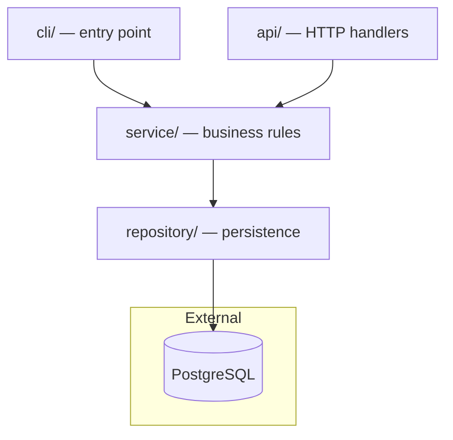
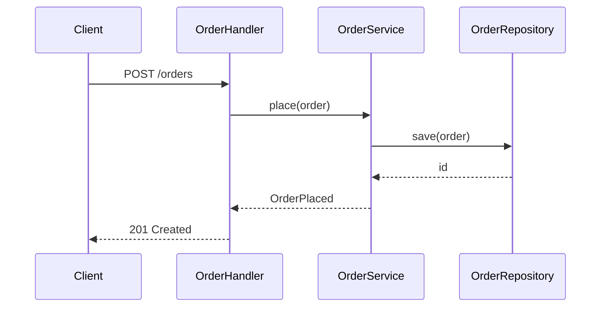

# Mermaid diagrams

Every diagram a skill writes — in chat, in a report, in `docs/codebase/` — is
a fenced ```` ```mermaid ```` block. No ASCII art, no indented trees, no
images. Mermaid renders on GitHub and in the IDE preview, and stays a
reviewable text diff.

## Pick the diagram for the job

| Job | Diagram | Start with |
| --- | --- | --- |
| layers, modules, services and which way dependencies point | flowchart | `flowchart TD` |
| one runtime path: who calls whom, in order | sequence | `sequenceDiagram` |
| key abstractions and one implementation of each | class | `classDiagram` |
| a lifecycle: job, order, deployment states | state | `stateDiagram-v2` |
| data shapes and their relations | entity-relationship | `erDiagram` |
| before/after of a structure | two flowcharts | `flowchart LR` each |

One diagram answers one question. When a picture needs more than about
15 nodes, split it (one per layer, or one overview plus one zoom) rather
than shrink it.

## Draw from evidence

- Every node is something that exists in the repository: a directory,
  module, class, function, service, queue or table. Label it with the real
  name; add the path when the reader will look for it
  (`api["api/ — HTTP handlers"]`).
- Every edge is a call, an import, a message or a data flow you read in the
  code. Label edges whose meaning is not obvious (`-->|publishes OrderPlaced|`).
- Arrows point the way the dependency or the call goes, never the reverse.
- External systems (databases, brokers, third-party APIs) go in a
  `subgraph External` or use the cylinder shape `db[(orders DB)]`.
- Group by real boundaries with `subgraph`: a layer, a deployable, a package.

## Syntax that renders the first time

- Quote any label with spaces, punctuation, slashes or parentheses:
  `svc["OrderService.place()"]`. Unquoted `()`, `[]`, `{}` change the shape.
- Node IDs are short, alphanumeric and unique: `api`, `orderSvc`, `db1`.
  Never use `end`, `graph`, `subgraph`, `class` or `style` as an ID;
  `end` in lowercase breaks the whole flowchart.
- No `<br>` tricks or HTML in labels unless the renderer is known to allow
  it; keep labels to one short line.
- In `sequenceDiagram`, declare `participant` lines first, in the order the
  reader meets them, and alias long names: `participant OS as OrderService`.
- No theme, `%%{init}%%` or `classDef` colour styling. Diagrams must read in
  light and dark themes with the renderer's defaults.
- One blank line before and after the fence; nothing else on the fence line
  but `` ```mermaid ``.

## Validate

When `mmdc` (`@mermaid-js/mermaid-cli`) is on `PATH`, render each diagram
once and fix any error before handing it over:

```
mmdc -i diagram.mmd -o /dev/null
```

Never install it unasked. Without it, check by hand: first line is a
diagram type from the table above, every quote and bracket is closed, no
reserved word is an ID, every edge refers to a declared or inline node.

## Viewing

Say this once, in the handoff, when a file with diagrams was written:

- **GitHub / GitLab:** renders Mermaid in Markdown natively.
- **VS Code:** built-in Markdown preview needs the *Markdown Preview Mermaid
  Support* extension (`bierner.markdown-mermaid`).
- **JetBrains:** enable the Mermaid option in Settings → Languages &
  Frameworks → Markdown, or install the *Mermaid* plugin.
- **Anywhere else:** paste the block into <https://mermaid.live>.

## Examples

Layers:



Core flow:


