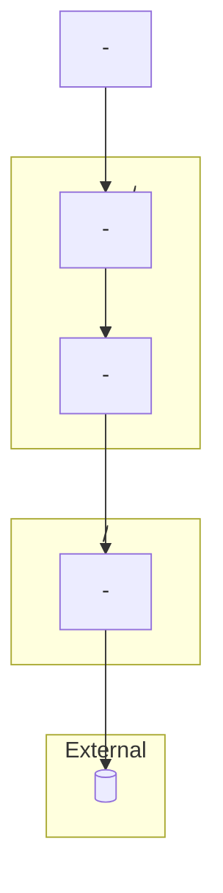
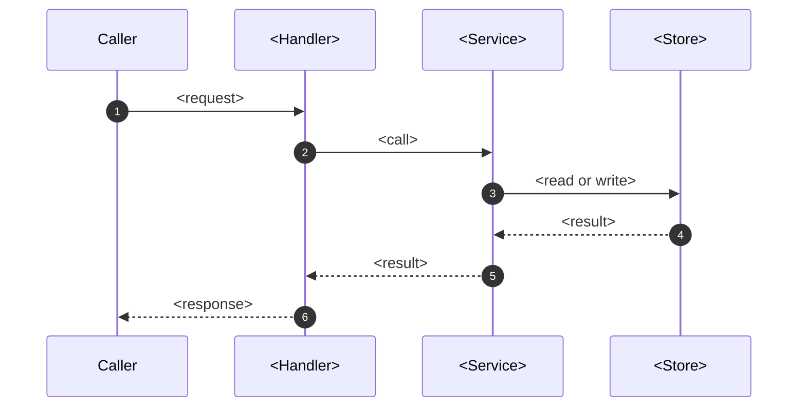
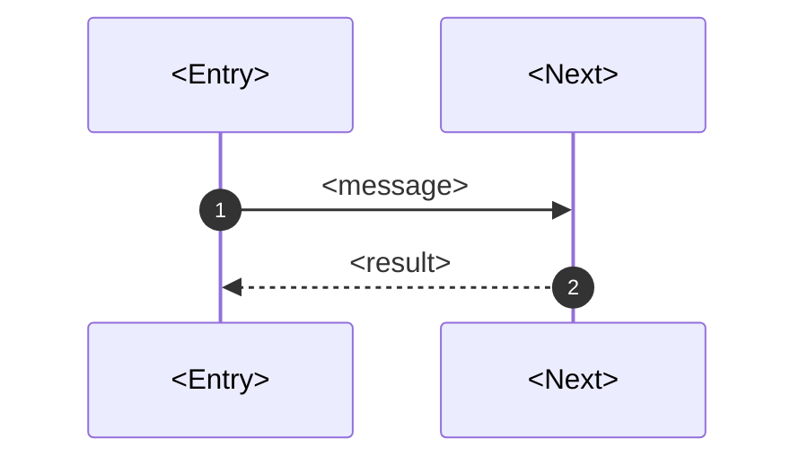

# Guide templates

Skeletons for the files in `<ROOT>/.onboarding/`, their line budgets and the
anchor check. The headings are the contract; fill every `<placeholder>` from
the evidence ledger and delete any template line you cannot anchor.

## Contents

- Header and evidence rules
- README.md
- flows/NN-slug.md
- reviewing-prs.md
- modules.md
- Anchor check

## Header and evidence rules

Every file opens with:

```
> Built from commit `<sha>` (<date>, branch `<branch>`). Every claim cites `path:line`.
```

`README.md` adds a second line: `> Evidence: <N> of <M> source files read; [?] marks what the code does not
settle.` The commit line lets later readers detect a stale guide with
`git diff --name-only <sha> HEAD`.

An anchor is `` `path:line` `` or `` `path:line-line` ``, the path relative to
`ROOT`, with forward slashes. Label what the code does not settle `[?]`.
A claim backed only by a document (README, ADR, an overview doc) is written
as "the README says ..." and checked against the code before it is repeated.

## README.md

Budget up to 400 lines (a small repository is shorter). The diagrams below are valid skeletons: replace the
names, keep the shape.

````markdown
# <repo> - onboarding guide

> Built from commit `<sha>` (<date>, branch `<branch>`). Every claim cites `path:line`.
> Evidence: <N> of <M> source files read; `[?]` marks what the code does not settle.

## 1. What this is

<= 6 lines: what the repository does, language and framework, how many
deployables, each claim cited.

## 2. System map



- `<path>` - <what it owns>, <which way its dependencies point>.
(five to eight bullets, each with a path)

## 3. Run it, test it

| Task | Command | Source |
| --- | --- | --- |
| Run | `<command>` | `<path:line>` |
| Test | `<command>` | `<path:line>` |

Commands are quoted from the README, manifests and CI; this guide did not run them.

## 4. Reading order

1. `<path:line>` - <what to read now>. Afterwards you can say <one sentence>.
(at most ten entries)

## 5. Core flow: <name>

Chosen because <rule from the flow-picking order>.



1. **<Step name>.** `<path:line>` <what runs, why it is here, what breaks without it>.

## 6. Data and state

Only when the code has tables, models or a state field; otherwise one line
saying there are none. `erDiagram` or `stateDiagram-v2` here.

## 7. Conventions and tests

Naming and layout at one real example each (`path:line`), error and logging
idioms, test layout and how one test is run, the one thing this repository
does differently from its ecosystem's default.

## 8. Glossary

At most 12 domain terms found in the code, each with the `path:line` where it
is defined.

## 9. Open questions

1. [?] <what the code does not settle> (`<path:line>`)

## Evidence

Files read: <N> of <M>. Commit `<sha>`. Not read: <areas>.
````

## flows/NN-slug.md

Budget up to 200 lines, one flow per file, at most three files.

````markdown
# Flow: <what runs>

> Built from commit `<sha>` (<date>, branch `<branch>`). Every claim cites `path:line`.

Entry: `<path:line>`. Triggered by <who or what>. Ends when <response, file,
exit code, message published>.



1. **<Step>.** `<path:line>` <what runs, why, what breaks without it>.

## Branches not followed

<Alternative paths named in the step that passes them, one line each.>
````

Add a `stateDiagram-v2` only when the flow moves a real state field or enum
through values you read.

## reviewing-prs.md

Budget up to 150 lines. Built from the same ledger; no second investigation.

````markdown
# Reviewing a PR in <repo>

> Built from commit `<sha>` (<date>, branch `<branch>`). Read `README.md`
> sections 2 and 5 first.

## Area map

| Glob | Area | Flow | Depends on it | Tests |
| --- | --- | --- | --- | --- |
| `<dir>/**` | <area> | `flows/01-<slug>.md` | `<path>` | `<test path>` |

With `git diff --name-only <base>...<head>` in hand, one lookup names the
areas and flows a PR touches.

## Hotspots (most changed files, last 12 months)

| File | Commits | Why read twice |
| --- | --- | --- |
| `<path>` | <n> | <reason found in the code> |

## Silent seams

- `<path:line>` - <invariant the code relies on but does not enforce>.

## Questions to ask, by area

- <area>: <question grounded in this repository's code>.

## Run one test, by area

| Area | Command | Source |
| --- | --- | --- |
| <area> | `<command>` | `<path:line>` |

## Next

Understand the PR with this map: `/skill:roj-explain-logic PR <n>` in
JetBrains, `/roj-explain-logic PR <n>` in VS Code. Then
`roj-code-review-pr PR <n>`, and `roj-review-pr-comment PR <n>` for Bitbucket
comments. A PR review adds non-blocking suggestions after the defects; say
`no suggestions` for defects only.
````

## modules.md

Budget up to 300 lines, written last. One `flowchart` per module group (at most
15 nodes), then a table `module | owns | depends on | depended on by`, each
cell anchored. `classDiagram` only for three or more real types; `erDiagram`
only for tables or models that exist.

## Anchor check

Run from any directory; it never writes. Exit 1 on any bad anchor.

```
python3 check-anchors.py <ROOT> <ROOT>/.onboarding/README.md <ROOT>/.onboarding/reviewing-prs.md
```

Use `python` when `python3` is missing (Windows). Save the script to a scratch
file outside the repository, never inside it. `check-anchors.py`:

```python
import re, sys
from pathlib import Path

root = Path(sys.argv[1])
ANCHOR = re.compile(r"`([\w./@+-]+):(\d+)(?:-(\d+))?`(?:-`(\d+)`)?")
bad = ok = 0
for md in sys.argv[2:]:
    for m in ANCHOR.finditer(Path(md).read_text(encoding="utf-8")):
        path, start = m.group(1), int(m.group(2))
        end = int(m.group(3) or m.group(4) or start)
        if "." not in path and "/" not in path:
            continue                      # host:port, not a file
        if re.fullmatch(r"[\d.]+", path):
            continue                      # an address such as 127.0.0.1:8080
        f = root / path
        n = len(f.read_text(encoding="utf-8", errors="replace").splitlines()) if f.is_file() else 0
        if not f.is_file() or start < 1 or end < start or end > n:
            bad += 1
            print(f"BAD {md}: {path}:{start}-{end} (file has {n} lines)")
        else:
            ok += 1
print(f"anchors ok={ok} bad={bad}")
sys.exit(1 if bad else 0)
```

An anchor in a quoted code sample of someone else's text, or a placeholder
such as `<path:line>`, is not matched. A BAD line is repaired from the ledger
or dropped.
