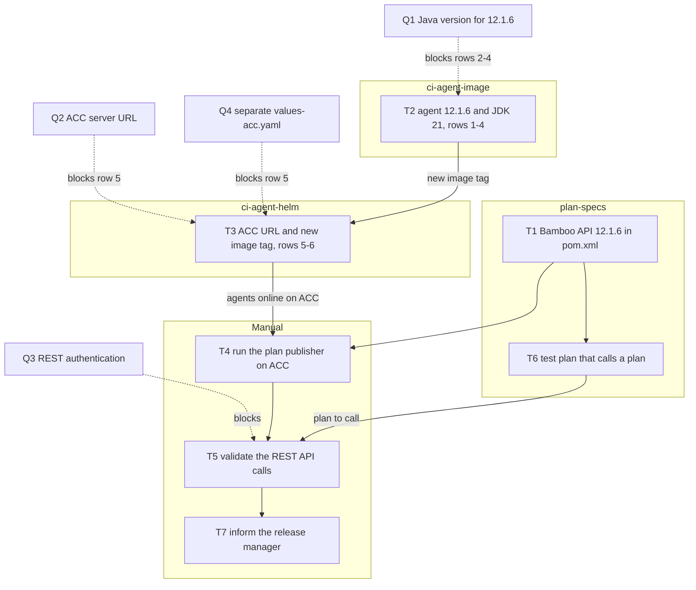
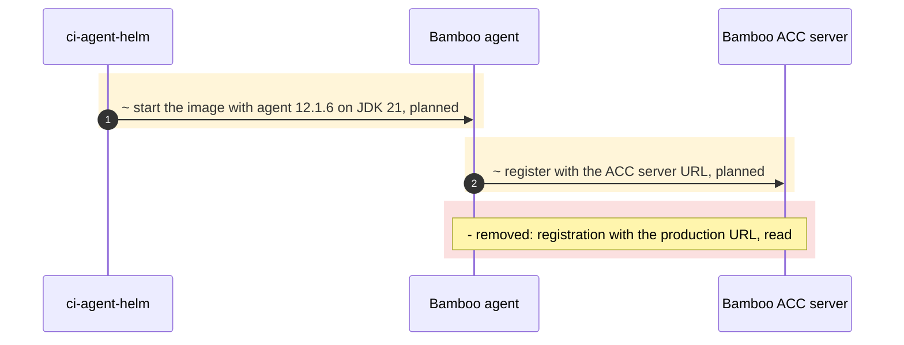

# Example Platform / PROJ-1001

> Goal: Validate that all Bamboo agents and build plans are compatible and operational in the acceptance (ACC) environment after its upgrade to Bamboo 12.1.6.

## Acceptance Criteria

- [ ] A PR is prepared in which our Maven dependency is updated to use the new Bamboo API version
  - [ ] POM is updated
- [ ] A test is performed against the ACC environment from our local development environment to see if we can deploy several plans
- [ ] The plan publisher is executed on ACC
  - [ ] It should be able to deploy all plans
  - [ ] It should succeed running all unit tests
- [ ] It is checked if we can still communicate with the various Bamboo REST APIs
  - [ ] We add a simple test plan which can call another plan and read out the results to at least test the Bamboo API functionality
  - [ ] Code is adapted if needed
- [ ] If any critical issue is found that is not easy to solve, the responsible team is informed
  - [ ] Inform the release manager that not everything can be tested (ACC is isolated from external systems)
  - [ ] The prepared PR is kept up to date until the new Bamboo version is released to production
- [ ] All remote agents run the Java version confirmed in the first Question. *(proposed)*
- [ ] `ci-agent-image` and `ci-agent-helm` changes are reviewed and merged. *(proposed)*
- [ ] A new agent image is built, tagged and published after the repository changes. *(proposed)*
- [ ] The Helm chart is deployed to ACC with the new image tag and the ACC server URL, and agent connectivity is confirmed. *(proposed)*

## Implementation plan

### Approach

> **Draft:** written by the agent from its investigation. Confirm or edit it before implementation.

- Upgrade the agents before testing the plans: build the agent image on 12.1.6 and JDK 21, then deploy it to ACC with the new tag, and only then run the plan publisher and the REST checks against ACC.
- Keep the ACC Helm values in their own `values-acc.yaml` (Question 4), so agents under test never register with the production server (`values.yaml:9`).
- The `plan-specs` changes do not depend on the agents and can start at once; the publisher run waits for both.

### Task flow

### Change flow

## Core tasks

- [ ] `plan-specs`: update the Bamboo API dependency in `pom.xml` to 12.1.6.
- [ ] `ci-agent-image`: apply the agent changes in the first table below.
- [ ] `ci-agent-helm`: set the ACC server URL and the new image tag (second table below).
- [ ] Run the plan publisher on ACC and confirm all plans deploy.
- [ ] Validate Bamboo REST API communication: check every call our integrations make (see the authentication Question).
- [ ] `plan-specs`: add a test plan that calls another plan and reads back its result.
- [ ] Inform the release manager about the scenarios ACC isolation prevents us from testing.

### `ci-agent-image`

| # | File/Property | Location | Before | After | Reason | Source |
|---|---|---|---|---|---|---|
| 1 | `BAMBOO_VERSION` | `docker/Dockerfile:12` | `9.6.9` | **`12.1.6`** | The image pins an older agent version than the upgraded server. | story: goal |
| 2 | `wrapper.java.version.min` | `docker/wrapper.conf:7` | `8` | **`21`** *(proposed)* | The wrapper still allows a JDK 8 start; the target Java version is not confirmed. | Question 1 |
| 3 | `wrapper.java.version.fallback` | `docker/wrapper.conf:8` | `11` | **`21`** *(proposed)* | Same as row 2 for the fallback. | Question 1 |
| 4 | `JAVA_FALLBACK` | `docker/agent.sh:5` | `/opt/java/jdk-8/bin/java` | **`/opt/java/jdk-21/bin/java`** *(proposed)* | The fallback path still points at JDK 8. | Question 1 |

> **Already compliant (checked, no change needed):**
> - `docker/Dockerfile:20` sets `JAVA_HOME` to `/opt/java/jdk-21`.
> - `docker/wrapper.conf:15-17` already carries the `--add-opens` JVM flags.

### `ci-agent-helm`

| # | File/Property | Location | Before | After | Reason | Source |
|---|---|---|---|---|---|---|
| 5 | `agent_server_url` | `values.yaml:9` | production URL | ACC server URL (in `values-acc.yaml`) *(proposed)* | Agents under test must not register with the production server. | story: goal; Question 2; Question 4 |
| 6 | `imagetag` (all 4 pools) | `values.yaml:14,24,34,44` | `2026-02-17_13-53` | new image tag | The current tag is the image built from `ci-agent-image` before this change. | story: goal |

## Questions

- Which Java version does Bamboo 12.1.6 require on remote agents? Not verified here - check the vendor's release notes. Rows 2-4 assume 21 until then.
- What is the confirmed ACC server URL for `agent_server_url`? It is not in any checked-out repository.
- Does 12.1.6 change the REST authentication our integrations rely on? Not verified here - check the vendor's release notes before the REST validation task.
- Should we keep a dedicated `values-acc.yaml` so ACC and production Helm values never mix?
- Repo `plan-publisher` is not cloned locally - investigate before implementation.

## Notes

- ACC is isolated from some external systems, so not every scenario can be tested there (story).
- Impacted repositories: `plan-specs`, `ci-agent-image`, `ci-agent-helm`, `plan-publisher` (not cloned).

## Testing

| Test Case ID | Situation | Expected result | Log | Build result link |
|--------------|-----------|-----------------|-----|-------------------|
| TC-1 | Run the plan publisher against ACC | All plans deploy without errors | | |
| TC-2 | Run the `plan-specs` unit tests on the new API version | All tests pass | | |
| TC-3 | Run the new test plan that calls a second plan | The second plan's result is read back | | |
| TC-4 | Deploy the Helm chart to ACC with the new image | All 4 agent pools show **Online** | | |
| TC-5 | Inspect an agent build log | The agent starts on the Java version confirmed in Question 1 | | |
